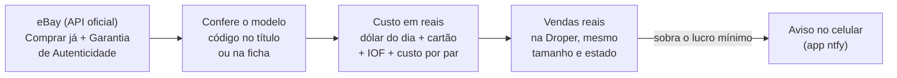

# Alerta eBay → Droper

[](https://github.com/josesoares28/alerta-ebay/actions/workflows/alerta.yml)

Avisa no celular quando aparece no eBay um tênis que dá lucro para revender no Brasil.

A cada 30 minutos, de graça e com o PC desligado, o programa:
1. procura no eBay os modelos da sua lista;
2. calcula quanto custaria trazer cada par;
3. compara com o que pares iguais venderam de verdade na Droper, no mesmo tamanho.

Só avisa quando sobra o lucro mínimo que você escolheu.

## Como funciona



1. **Busca.** Usa a API oficial do eBay. Só entram anúncios "Comprar já" com Garantia de Autenticidade, entregues nos EUA e nos tamanhos de cada modelo.
2. **Confere o modelo.** O código do modelo (Style Code, ex.: `DD1391-100`) precisa estar no título ou na ficha do anúncio. Assim um Jordan 1 High não passa por Low, nem um Jordan 6 pelo Jordan 1 de mesmo nome. Ficam de fora:
   - par infantil, mesmo quando só a descrição diz que é;
   - réplica e caixa vazia;
   - usado em estado "Fair" (gasto).
3. **Calcula o custo** em reais: preço mais frete, pelo dólar do Banco Central do dia, com o spread do cartão, o IOF e o custo fixo para trazer cada par.
4. **Compara com a Droper.** Usa a mediana das últimas vendas no mesmo tamanho e estado. Modelo que vende pouco leva desconto, porque para vender logo é preciso pedir menos.
5. **Avisa no celular** o que deixa o lucro mínimo. O aviso diz até quanto vale pagar e quanto propor quando o vendedor aceita oferta.

### Exemplo de aviso

Ilustrativo, com números inventados:

> **Jordan 1 Low OG: US$ 95,00 (novo) tam 10**\
> Lucro ~R$ 741: Droper 42 novo R$ 1.899 (mediana das últimas vendas; 4 venda(s) em 30 dias no tamanho) → você recebe R$ 1.652; custo R$ 911. Dá o lucro mínimo pagando até US$ 139,73\
> novo com caixa · frete grátis\
> Vendedor exemplo123 · 99,8% (1204 avaliações)\
> Anunciado 12/10 21:40\
> Nike Air Jordan 1 Retro Low OG Size 10 Brand New

O aviso vem com a foto do anúncio e o botão **Abrir no eBay**.

Também dá para pedir a **lista completa**: chega um aviso por modelo, com todos os anúncios no alvo, o de maior lucro primeiro.

## O que é público e o que é privado

O repositório é público. Assim os minutos do GitHub são ilimitados e dá para usar o temporizador que marca o intervalo entre as rodadas: no plano grátis, ele só existe em repositório público.

| Público (este repositório) | Privado |
|---|---|
| Código, atalhos e esta página | Pasta `dados/`: modelos e preços-teto, custos, vendas e preços da Droper |
| Arquivos de exemplo em `exemplos/` | Chaves do eBay e tópico do celular |
| Histórico das rodadas, só com contagens (sem modelos nem links) | Estado das rodadas e log detalhado |

- **Dados:** ficam só no PC (estão no `.gitignore`). A nuvem recebe a pasta `dados/` por um segredo do GitHub (`DADOS_PRIVADOS`), que ninguém consegue ler. É o `ENVIAR-PARA-NUVEM.bat` que manda.
- **Chaves e tópico do celular:** ficam nos segredos do repositório e no `config.json`, que também não vai para o GitHub.

## Estrutura

```
alerta-ebay/
├── alerta.py            o programa: busca, confere, calcula o lucro e avisa
├── configurar.py        primeira configuração (chaves do eBay, celular, pasta dados)
├── nuvem.py             envia seus dados (num segredo) e o código para o GitHub
├── *.bat                atalhos de dois cliques para o Windows
├── exemplos/            formato dos arquivos de dados, com números de exemplo
├── dados/               SEUS dados (só no PC, fora do GitHub)
└── .github/workflows/   as rodadas na nuvem, a cada ~30 minutos
```

## Como usar

### Primeira vez

1. **Crie a conta de desenvolvedor do eBay** (grátis) em [developer.ebay.com](https://developer.ebay.com):
   - em **Application Keysets**, crie um keyset de **Production**;
   - se o eBay pedir "Marketplace Account Deletion", marque que não guarda dados de usuários.
2. **Instale o app [ntfy](https://ntfy.sh)** no celular. É ele que recebe os avisos.
3. **Clique duas vezes em `CONFIGURAR.bat`:**
   - cole o App ID e o Cert ID do eBay;
   - informe o CEP do endereço nos EUA;
   - assine no ntfy o tópico que aparecer.

   Ele também cria a pasta `dados/` com os exemplos.
4. **Troque os exemplos de `dados/`** pelos seus modelos, custos e vendas da Droper (veja "Arquivos de dados").
5. **Leve tudo para a nuvem:**
   - `ENVIAR-CHAVE-GITHUB.bat` leva o Cert ID;
   - `ENVIAR-PARA-NUVEM.bat` leva os dados e o código.

### Atalhos

| Atalho | Para quê |
|---|---|
| `VER-ANUNCIOS-AGORA.bat` | Mostra na tela tudo que está no alvo agora (não avisa) |
| `LISTA-NO-CELULAR.bat` | Manda para o celular a lista completa, um aviso por modelo |
| `ENVIAR-PARA-NUVEM.bat` | Leva para a nuvem as mudanças em `dados/` e no código |
| `ENVIAR-CHAVE-GITHUB.bat` | Leva o Cert ID do eBay para os segredos do GitHub |
| `DESLIGAR.bat` / `LIGAR.bat` | Pausa / volta a verificação na nuvem (o `LIGAR.bat` já faz uma rodada na hora) |
| `CONFIGURAR.bat` | Primeira configuração |

Pelo celular: github.com > alerta-ebay > Actions > Alerta eBay > **Run workflow**. Marque "Mandar a lista completa" para receber tudo e deixe os campos de uso interno desmarcados.

## Arquivos de dados (`dados/`)

Todos abrem no Excel ou no Bloco de Notas, separados por `;` e com vírgula decimal.

### `produtos.csv`: o que vigiar

Uma linha por modelo:

| Coluna | O que é |
|---|---|
| `ativo` | `S` = vigiando, `N` = pausado |
| `nome` | Como aparece no aviso |
| `sku` | Código do modelo (Style Code). Mais de um: separe com `/` |
| `busca` | Palavras da busca no eBay |
| `exigir` | Palavras que o título precisa ter quando não traz o código. Grupos separados por vírgula; `/` = "ou". Ex.: `dunk, panda/white black` |
| `excluir` | Palavras que descartam o anúncio (ex.: `high, mid, gs`) |
| `tam_min` / `tam_max` | Tamanhos US (ex.: `8,5` e `12`) |
| `max_novo` / `max_usado` | Teto em US$ (em branco = não quero novo / usado) |
| `so_com_garantia` | `S` = só com Garantia de Autenticidade |
| `feminino` | `S` = modelo feminino: tamanhos em W (W 10 = masculino 8,5 = BR 40) |

### `ajustes.txt`: custos e regras

Traz o custo fixo por par, a parte da venda que fica com você na Droper, o spread do cartão, o IOF, o sales tax dos EUA, a folga para oferta e o lucro mínimo (em R$ e em % do custo). Cada linha tem um comentário explicando.

### `vendas-droper.csv` e `precos-droper.csv`: a Droper

- **`vendas-droper.csv`:** vendas reais por tamanho e estado. Traz quantas vendas houve em 30, 90 e 180 dias e a mediana das 5 últimas, lidas do Market+ (Análise por Drop).
- **`precos-droper.csv`:** o menor anúncio de hoje em cada tamanho.

Atualize os dois de tempos em tempos e rode o `ENVIAR-PARA-NUVEM.bat`.

## Regras do lucro

```
custo     = (preço + frete) × dólar do dia × (1 + cartão) × (1 + IOF) × (1 + sales tax)
            + custo fixo por par
vende por = mediana das 5 últimas vendas na Droper no tamanho e estado
recebe    = vende por × (1 − desconto por giro) × parte que fica com você
lucro     = recebe − custo
```

- **Tamanho com menos de 2 vendas em 6 meses:** vale a mediana do modelo.
- **Par novo:** se hoje houver anúncio mais barato na Droper, vale ele.
- **Desconto por giro**, conforme as vendas do modelo em 30 dias:

  | Vendas no mês | Desconto |
  |---|---|
  | 4 ou mais | 0% |
  | 2 ou 3 | 5% |
  | 1 | 10% |
  | nenhuma | 15% |

- **Alvo:** o menor entre o teto do `produtos.csv` e o preço que ainda deixa o lucro mínimo, em reais e em % do custo.
- **Aceita oferta:** anúncio um pouco acima do alvo entra se o vendedor aceita oferta. O aviso sugere quanto propor.
- **Baixou!:** avisa quando um anúncio já avisado cai pelo menos US$ 10 e 3%.
- **⚠** marca o que merece desconfiança. Esses vão para o fim da lista:
  - a ficha diz outro modelo;
  - o preço está abaixo de 30% do que o par vale na Droper. Os achados de verdade ficam entre 35% e 60%.
- **"vendedor sem avaliações":** conta nova no eBay.

## Limites e cuidados

- **Cota do eBay:** 5.000 consultas por dia para cada chave, somando nuvem e PC.
  - Cada rodada gasta umas 35.
  - Anúncio de vários tamanhos é aberto uma vez e guardado de 4 a 8 horas.
  - Se a cota acabar, o programa para sem erro e volta quando ela renova, às 4h (5h no horário de inverno dos EUA).
- **Rodadas no GitHub:**
  - O agendador do GitHub quase não dispara em 2026. Por isso cada rodada agenda a próxima: espera 28 minutos no ambiente `intervalo` (um temporizador do GitHub que não gasta minutos) e, no fim, dispara a seguinte.
  - Na aba Actions deve aparecer uma "Rodada automática" a cada ~30 minutos. Se elas pararem, ou se chegar no celular o aviso "Alerta eBay parou", rode o `LIGAR.bat`. Um agendamento de reserva, a cada 2 horas, também religa as rodadas quando o GitHub dispara.
  - O GitHub desliga workflow com agendamento em repositório público sem mudanças há 60 dias. Por isso, depois de 30 dias parado, a própria rodada grava a data em `ativo.txt`.
- **O lucro é uma estimativa.** Antes de comprar, confira as fotos, o vendedor e o preço de hoje na Droper.
